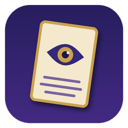
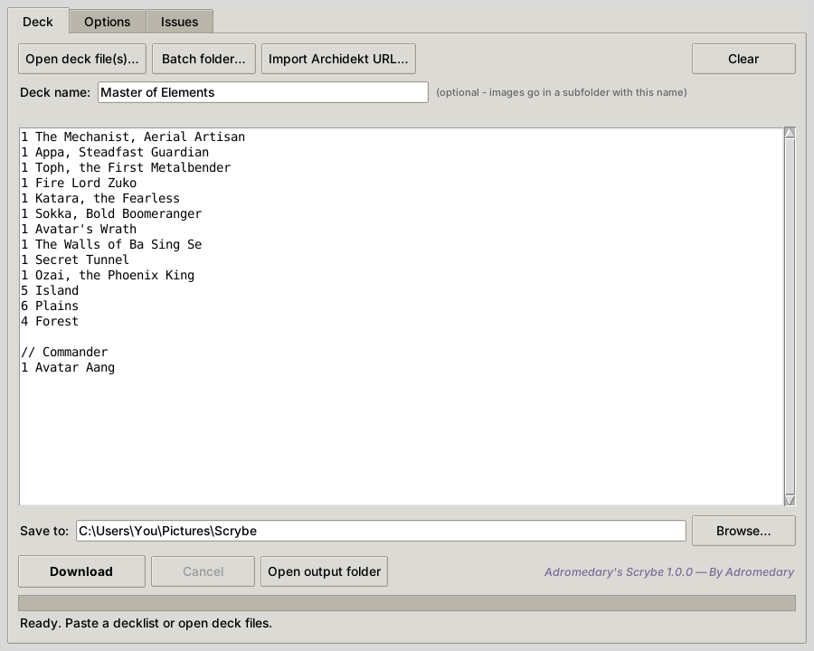
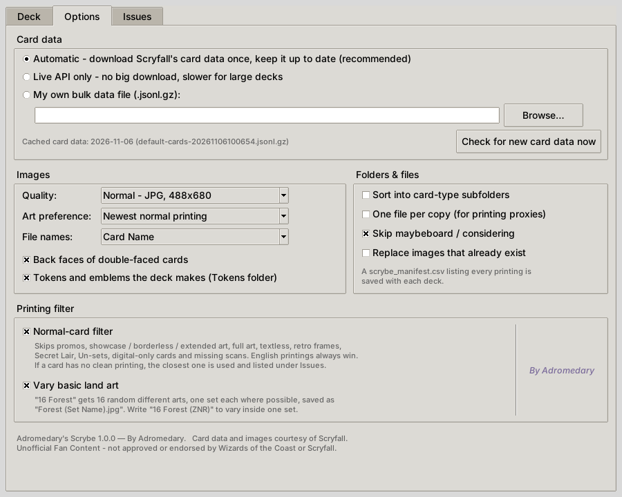
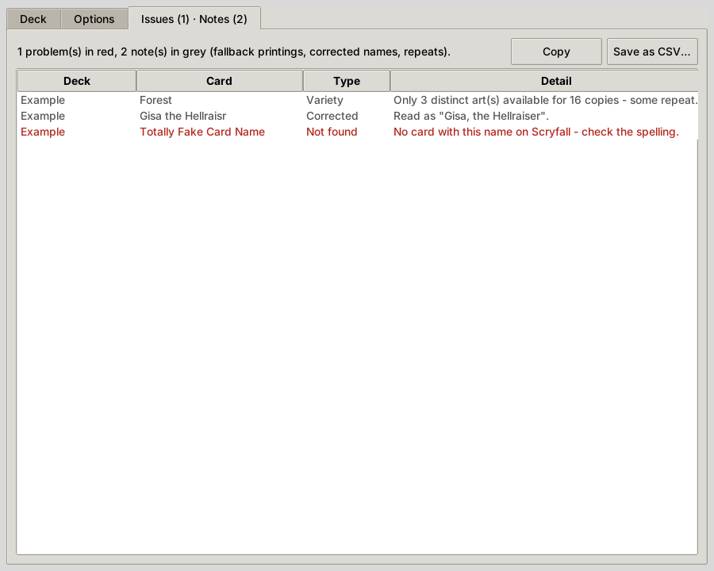

<p align="center">
  
</p>

<h1 align="center">Adromedary's Scrybe</h1>

<p align="center">
  Paste a Magic: The Gathering decklist, get a folder of clean card images.<br>
  A small Windows app that picks the most normal-looking English printing of every card on Scryfall.
</p>

<p align="center">
  <a href="../../releases/latest"><b>Download Scrybe.exe</b></a> ·
  <a href="#using-it">How to use</a> ·
  <a href="#building-from-source">Build from source</a>
</p>



## Why

Bulk-downloading card images usually gets you whatever printing a site lists first: a
Secret Lair, a borderless showcase, a foreign-language promo with no scan, a full-art
land with no text. Scrybe ranks every printing of every card and takes the one that looks
like an ordinary Magic card, so a deck's images look like they belong together.

## Features

- **Reads any common decklist**: plain text, MTG Arena, Moxfield and Archidekt exports
  (`1 Sol Ring (C21) 263 *F*`), Forge `.dck` and MTGO `.dek` files, with Commander,
  Sideboard and Maybeboard sections.
- **Picks clean printings**: skips promos, showcase, borderless and extended art, full
  art, textless, retro frames, Secret Lair, Un-sets, The List, digital-only cards and
  missing scans. English printings always win. When a card has no clean printing, the
  closest one is used and noted.
- **Varies basic lands**: `16 Forest` gets 16 different random arts, one set each where
  possible, saved as `Forest (Bloomburrow).jpg`. `16 Forest (ZNR)` varies inside
  Zendikar Rising.
- **Honours your choices**: a set code plus collector number gets exactly that printing;
  a set code alone gets the best printing from that set.
- **Fixes typos** with Scryfall's fuzzy search and lists every correction.
- **Batch mode**: point it at a folder of decklists and each deck gets its own subfolder.
- **Archidekt import** from a public deck link.
- **Extras**: back faces of double-faced cards, the tokens and emblems a deck makes,
  one file per copy for proxy printing, card-type subfolders, and a CSV manifest of
  every printing saved.
- **Fast and polite**: caches Scryfall's bulk card data (about 80 MB, refreshed when
  Scryfall publishes new data), downloads 4 images at a time, respects Scryfall's rate
  limits, and retries timeouts at the back of the queue up to 3 times.
- **No dependencies**: one Python file using only the standard library; one `.exe`.

## Using it

1. Download `Scrybe.exe` from [Releases](../../releases/latest) and run it.
   Windows may say *"Windows protected your PC"* because the app isn't code-signed;
   click **More info → Run anyway**.
2. Paste a decklist, or use **Open deck file(s)**, **Batch folder** or
   **Import Archidekt URL**.
3. Choose where to save and press **Download**.

The first run downloads Scryfall's card data and indexes it (about 15 seconds). After
that, startup takes a couple of seconds. Prefer no big download? Choose
**Live API only** on the Options tab.

### Decklist syntax

| You write | Scrybe does |
|---|---|
| `1 Lightning Bolt` | Best normal printing |
| `1 Lightning Bolt (2X2)` | Best printing from Double Masters 2022 |
| `1 Lightning Bolt (2X2) 117` | Exactly that printing, filter skipped |
| `16 Forest` | 16 different random arts, different sets |
| `16 Forest (ZNR)` | 16 Forests varied within Zendikar Rising |
| `1 Gisa the Hellraisr` | Corrected to *Gisa, the Hellraiser* and noted |
| `Maybeboard` header | Following cards skipped (optional) |

Moxfield blocks automated downloads, so for Moxfield decks use
**Export → Copy for MTGA** and paste the list.



### The Issues tab

Anything Scrybe couldn't do perfectly is listed here: problems in red (card not found,
download failed) and notes in grey (a fallback printing was used, a name was corrected,
a basic land art had to repeat). The list can be copied or saved as CSV.



*Screenshots are from the Linux build; on Windows the app uses the native window style.*

## How a printing is chosen

Each printing gets a "weirdness score" from Scryfall's card data: 0 is a completely
normal card. Points are added for a non-English language, a missing scan, digital-only,
non-game layouts, retired art, textless, a non-standard set type (promo, Secret Lair,
Un-set, memorabilia...), a non-black/white border, full art, promo flags, alternate-art
variations, timeshifted or retro frames, showcase/extended/borderless/etched frame
effects, and Universes Beyond art on basic lands.

Printings are then ranked by: English first → lowest score → art preference (newest
modern frame by default, or original printing, or classic old border). The full rules
are in `score_card()` and `rank_key()` in [`scrybe.py`](scrybe.py).

## Building from source

Requires Python 3.9 or newer (Windows: tick **Add python.exe to PATH** in the installer).

```bat
:: run without building
python scrybe.py

:: build Scrybe.exe into the dist folder
build.bat
```

`build.bat` installs [PyInstaller](https://pyinstaller.org) and builds a single-file,
windowed `Scrybe.exe` with the icon and version details. Every
[GitHub release](../../releases) also builds and attaches the `.exe` automatically
(see [`.github/workflows/build.yml`](.github/workflows/build.yml)).

### Tests

```bash
python tests/test_parser.py   # decklist formats and name matching
python tests/test_retry.py    # timeout requeue for downloads and lookups (offline)
```

`tests/decks/` holds sample lists used for manual end-to-end checks.

## Where it keeps things

Settings and cached card data live in `%LOCALAPPDATA%\AdromedarysScrybe`
(`~/.adromedarys_scrybe` on macOS and Linux). Delete that folder to reset everything.

## Credits and legal

Created by **Adromedary**.

Card data and images are provided by [Scryfall](https://scryfall.com) through its
[public API](https://scryfall.com/docs/api). Scrybe identifies itself to Scryfall and
stays within its rate limits.

Adromedary's Scrybe is unofficial Fan Content permitted under the
[Wizards of the Coast Fan Content Policy](https://company.wizards.com/en/legal/fancontentpolicy).
Not approved or endorsed by Wizards of the Coast or Scryfall. Portions of the materials
used are property of Wizards of the Coast. ©Wizards of the Coast LLC.

The code is released under the [MIT License](LICENSE).
